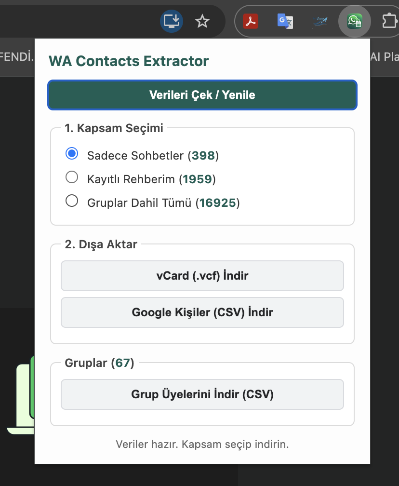

# WA Exporter – Export WhatsApp Web Contacts & Group Members to CSV / vCard

Export your WhatsApp Web contacts, 1-on-1 chats and group members to **Google Contacts CSV**, **Excel-ready CSV** and **vCard (.vcf)** — right in your browser, with no servers and no sign-up.

[](manifest.json)
[](https://developer.chrome.com/docs/extensions/mv3/intro/)
[](LICENSE)
[](https://github.com/aytugakar/wa-exporter/issues)
[](https://github.com/aytugakar/wa-exporter/discussions)

[English](#-english) • [Türkçe](#-türkçe)

<p align="center">
  
</p>

---

## 🌐 English

WA Exporter is a lightweight, privacy-focused Chrome extension (Manifest V3) that exports WhatsApp contacts, 1-on-1 chats and WhatsApp group members from WhatsApp Web. It reads the data WhatsApp Web already holds in your browser (its in-memory store, with IndexedDB as a fallback), so nothing is sent anywhere. Files can be imported into Google Contacts, phone address books, or opened in Excel / Google Sheets.

Built with vanilla JavaScript — no dependencies, no build step.

> **Languages:** the interface opens in **English** or **Turkish**, following your browser's language (English for every other language).

### ✨ Key Features

- **Export scopes:**
  - **Direct Chats Only:** people you have a 1-on-1 chat with; group members you never messaged are left out.
  - **Saved Contacts:** only contacts saved with a name in your address book.
  - **All, Including Groups:** every phone number WhatsApp Web knows as a contact, including unsaved people from your groups.
  - **Group Members:** every group with its participants' names and phone numbers.
- **Export formats:**
  - **vCard (.vcf):** import into iPhone, Android, macOS Contacts or Google Contacts.
  - **Google Contacts CSV:** uses Google's import headers (`Name`, `Given Name`, `Family Name`, `Phone 1 - Type`, `Phone 1 - Value`). Also opens in Excel.
  - **Group members CSV:** one row per participant, with `Group Name`, `Group ID`, `Participant Name` and `Phone` columns (column names follow the interface language).
- **Privacy-first:** runs 100% in your browser. The only permission requested is `activeTab`; there is no telemetry and no network request of any kind.

### 📋 Requirements

- Google Chrome or another Chromium-based browser (Edge, Brave, Opera…)
- A WhatsApp account signed in on [WhatsApp Web](https://web.whatsapp.com)

### 📥 Installation & Usage

1. **Download the code:**
   ```bash
   git clone https://github.com/aytugakar/wa-exporter.git
   ```
   Or use **Code → Download ZIP** on GitHub and unzip it.
2. **Load into Chrome:**
   - Go to `chrome://extensions/`.
   - Turn on **Developer mode** (top right).
   - Click **Load unpacked** and select the `wa-exporter` folder.
3. **Export:**
   - Open [WhatsApp Web](https://web.whatsapp.com), sign in and wait until your chat list has fully loaded.
   - Click the extension icon in the toolbar.
   - Click **Fetch / Refresh Data**. The counts appear next to each scope.
   - Choose a scope, then click **Download vCard (.vcf)** or **Download Google Contacts (CSV)**.
   - For group members, click **Download Group Members (CSV)**.
4. **Import into Google Contacts:**
   - Open [Google Contacts](https://contacts.google.com).
   - Click **Import** in the left menu and upload the CSV or VCF file.

### 🛠️ Troubleshooting

- **"An error occurred. Reload the page and try again.":** reload the WhatsApp Web tab, wait for the chats to load, and try again. Also reload the tab after installing or updating the extension.
- **Counts are low or a group has no members:** WhatsApp Web loads data gradually. Scroll through your chats or open the group once, then click **Fetch / Refresh Data** again.
- **It stopped working after a WhatsApp update:** the extension relies on WhatsApp Web's internal structure, which can change without notice. Please [open an issue](https://github.com/aytugakar/wa-exporter/issues).

### 🏗️ Architecture

```
┌────────────────────────────────────────────────────────┐
│                      WhatsApp Web                      │
│      [Webpack Store / ChatCollection / IndexedDB]      │
└───────────────────────────┬────────────────────────────┘
                            │ injected into the page
                            ▼
                    [page-script.js]
           (reads chats, contacts and groups)
                            │ window.postMessage
                            ▼
                     [content.js]
                (bridge to the extension)
                            ▲  │
     chrome.tabs.sendMessage│  │sendResponse
                            │  ▼
              [popup.html + popup.js]
       (UI, vCard / CSV builders, file download)
```

### 📂 File Structure

```text
wa-exporter/
├── _locales/
│   ├── en/messages.json  # English UI texts (default)
│   └── tr/messages.json  # Turkish UI texts
├── docs/
│   └── screenshot-popup.png
├── icons/
│   ├── icon16.png
│   ├── icon32.png
│   ├── icon48.png
│   └── icon128.png
├── manifest.json       # Manifest V3 configuration & permissions
├── popup.html          # Extension popup UI
├── popup.js            # UI logic and vCard / CSV export
├── content.js          # Bridge between the page and the popup
├── page-script.js      # Reads WhatsApp Web's internal store / IndexedDB
├── LICENSE
└── readme.md
```

### ⚠️ Disclaimer

- This project is **not affiliated with, endorsed or sponsored by WhatsApp or Meta**. "WhatsApp" is a trademark of its respective owner.
- It uses WhatsApp Web's internal, undocumented structures and may break at any time.
- Exported files contain other people's phone numbers. You are responsible for handling them in line with applicable data-protection laws (e.g. GDPR, KVKK) and WhatsApp's Terms of Service.

### 🤝 Community & Support

- 🐛 **Found a bug?** Open an [issue](https://github.com/aytugakar/wa-exporter/issues).
- 💡 **Feature idea?** [Open an issue](https://github.com/aytugakar/wa-exporter/issues/new) describing it.
- 💬 **Questions?** Join the [Discussions](https://github.com/aytugakar/wa-exporter/discussions).
- 🔀 **Contributions:** pull requests are welcome!

---

## 🇹🇷 Türkçe

WA Exporter, WhatsApp kişilerinizi, birebir sohbetlerinizi ve WhatsApp grup üyelerini WhatsApp Web üzerinden dışa aktaran, hafif ve gizlilik odaklı bir Chrome eklentisidir (Manifest V3). WhatsApp Web'in tarayıcınızda zaten tuttuğu verileri okur (bellekteki veri deposu, gerekirse IndexedDB); hiçbir veri dışarı gönderilmez. Oluşan dosyaları Google Kişiler'e veya telefon rehberinize aktarabilir, Excel ya da Google E-Tablolar'da açabilirsiniz.

Saf JavaScript ile yazılmıştır; bağımlılık veya derleme adımı yoktur.

> **Diller:** Arayüz, tarayıcınızın diline göre **Türkçe** veya **İngilizce** açılır (diğer dillerde İngilizce).

### 🌟 Özellikler

- **Dışa aktarma kapsamları:**
  - **Sadece Sohbetler:** Birebir sohbetiniz olan kişiler. Ortak gruplarda bulunup hiç mesajlaşmadığınız numaralar dahil edilmez.
  - **Kayıtlı Rehberim:** Yalnızca rehberinizde isimle kayıtlı kişiler.
  - **Gruplar Dahil Tümü:** WhatsApp Web'in kişi olarak tanıdığı bütün numaralar; gruplardaki kayıtsız kişiler de dahil.
  - **Grup Üyeleri:** Tüm gruplar, katılımcılarının isim ve telefonlarıyla birlikte.
- **Dışa aktarma formatları:**
  - **vCard (.vcf):** iPhone, Android, macOS Kişiler veya Google Kişiler'e aktarılabilir.
  - **Google Kişiler (CSV):** Google'ın içe aktarma başlıklarını kullanır (`Name`, `Given Name`, `Family Name`, `Phone 1 - Type`, `Phone 1 - Value`). Excel'de de açılır.
  - **Grup Katılımcıları (CSV):** Her katılımcı bir satır; sütunlar `Grup Adı`, `Grup ID`, `Katılımcı İsmi`, `Telefon` (sütun adları arayüz diline göre değişir).
- **Gizlilik odaklı:** Tüm işlemler tarayıcınızda yapılır. Eklenti yalnızca `activeTab` izni ister; hiçbir veri kaydedilmez, dışarıya hiçbir ağ isteği gönderilmez.

### 📋 Gereksinimler

- Google Chrome veya Chromium tabanlı bir tarayıcı (Edge, Brave, Opera…)
- [WhatsApp Web](https://web.whatsapp.com)'de oturum açılmış bir WhatsApp hesabı

### 📥 Kurulum ve Kullanım

1. **Projeyi indirin:**
   ```bash
   git clone https://github.com/aytugakar/wa-exporter.git
   ```
   Ya da GitHub'da **Code → Download ZIP** ile indirip arşivi açın.
2. **Chrome'a ekleyin:**
   - `chrome://extensions/` adresine gidin.
   - Sağ üstteki **Geliştirici modu** anahtarını açın.
   - **Paketlenmemiş öğe yükle** butonuna basıp `wa-exporter` klasörünü seçin.
3. **Dışa aktarın:**
   - [WhatsApp Web](https://web.whatsapp.com)'de oturum açın ve sohbet listeniz tamamen yüklenene kadar bekleyin.
   - Araç çubuğundaki eklenti simgesine tıklayın.
   - **Verileri Çek / Yenile** butonuna basın; her kapsamın yanında kişi sayısı görünür.
   - Bir kapsam seçip **vCard (.vcf) İndir** veya **Google Kişiler (CSV) İndir** butonuna tıklayın.
   - Grup üyeleri için **Grup Üyelerini İndir (CSV)** butonunu kullanın.
4. **Google Kişiler'e aktarın:**
   - [Google Kişiler](https://contacts.google.com) adresine gidin.
   - Sol menüden **İçe aktar**'a tıklayıp CSV veya VCF dosyasını yükleyin.

### 🛠️ Sorun Giderme

- **"Hata oluştu. Sayfayı yenileyip tekrar deneyin.":** WhatsApp Web sekmesini yenileyin, sohbetlerin yüklenmesini bekleyip tekrar deneyin. Eklentiyi kurduktan veya güncelledikten sonra da sekmeyi yenileyin.
- **Sayılar düşük ya da bir grubun üyeleri boş:** WhatsApp Web verileri parça parça yükler. Sohbet listesini aşağı kaydırın veya grubu bir kez açın, sonra **Verileri Çek / Yenile**'ye yeniden basın.
- **Bir WhatsApp güncellemesinden sonra çalışmıyor:** Eklenti WhatsApp Web'in iç yapısını kullanır ve bu yapı haber verilmeden değişebilir. Lütfen bir [hata kaydı (issue)](https://github.com/aytugakar/wa-exporter/issues) açın.

### ⚠️ Sorumluluk Reddi

- Bu proje **WhatsApp veya Meta ile bağlantılı değildir**, onlar tarafından onaylanmamış ya da desteklenmemektedir. "WhatsApp" ilgili sahibinin ticari markasıdır.
- Eklenti WhatsApp Web'in belgelenmemiş iç yapılarını kullanır ve her an çalışmayı durdurabilir.
- Dışa aktarılan dosyalar başkalarının telefon numaralarını içerir. Bu verileri KVKK, GDPR gibi veri koruma mevzuatına ve WhatsApp Kullanım Koşulları'na uygun şekilde kullanmak sizin sorumluluğunuzdadır.

### 💬 Katkı ve İletişim

- 🐛 Bir sorunla mı karşılaştınız? [Hata bildirin (issue)](https://github.com/aytugakar/wa-exporter/issues).
- 💡 Yeni bir özellik mi öneriyorsunuz? [İstek açın](https://github.com/aytugakar/wa-exporter/issues/new).
- 💬 Soru ve tartışmalar için: [Discussions](https://github.com/aytugakar/wa-exporter/discussions).
- 🛠️ Katkıda bulunmak için pull request gönderebilirsiniz.

---

## 👨‍💻 Author / Geliştirici

**A. Halil AKAR**
- ✉️ Email: [aytugakar@gmail.com](mailto:aytugakar@gmail.com)
- 🐙 GitHub: [@aytugakar](https://github.com/aytugakar)
- 💼 LinkedIn: [ahalilakar](https://www.linkedin.com/in/ahalilakar)

---

## 📄 License / Lisans

This project is licensed under the MIT License — see the [LICENSE](LICENSE) file for details.
Bu proje [MIT Lisansı](LICENSE) kapsamında lisanslanmıştır.
